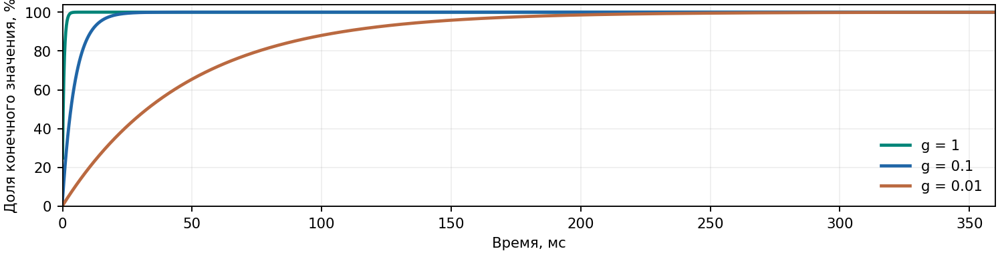

# MIRA.05 | Требования аналоговой части

**Результат: требования RevA зафиксированы как предварительный инженерный профиль; схема Control исправлена.** Проверены цепи задания напряжения, силовой путь, переключение полярности, токовый регулятор, TIA, ADC и независимый аварийный компаратор. Это схемный этап, а не подтверждение характеристик изготовленной платы.

Дата: 30 октября 2026. База: GitHub main **94d8c6f71845**; исходные файлы проекта сверены с деревом этого коммита. Power: 61 лист, Control: 43 листа. Предыдущие исправления и отсрочка MIG/Vivado сохранены.

| Режим | Предел задания платформы | Ток / одновременность |
| --- | --- | --- |
| READ | 0...0,5 В; первая проба 0,1 В | До 8 мА суммарно, с ограничением выбранного TIA; один NL |
| SET | 0...5 В; знак задаётся профилем | 10 мкА...8 мА; одна ячейка |
| RESET | 0...5 В; знак задаётся профилем | 10 мкА...8 мА; одна ячейка |
| FORMING | 0...8 В; знак задаётся профилем | 10 мкА...8 мА; одна ячейка |

**Эти цифры не являются допустимыми режимами неизвестного мемристора.** Напряжения SET/RESET/FORMING, допустимые пиковый ток и энергия, сопротивления и параметры WL для образца пока неизвестны. До заполнения профиля матрицы программирование и forming запрещены. Даже первое чтение требует подтверждения безопасного напряжения образца.

## Что изменено физически

U2109: INA821 заменён на INA149AIDR с другой распиновкой; обратная связь выхода из насыщения берёт буферизованную команду. R2111: 13,7 кОм → 10 кОм, потолок команды 11,9 → 10,05 В. R2301/R2302: точные 1 МОм / 31,6 кОм, 0,1%, 0603; прежний порог P15 около 12,04 В повышен до 13,22 В. Также сохранены исправления пары CV 100/101 кОм и артикулов резисторов. Всего изменены 12 записей компонентов; число компонентов не изменилось.

## Что можно закрыть

Карточку «зафиксировать требования» можно закрывать как документированный схемный этап с условиями этого отчёта. Нельзя этим результатом закрывать проверку пикового тока, быстродействия, устойчивости, точности, теплового режима или совместимости с конкретной матрицей. У каждой из этих проверок есть отдельный критерий на страницах 8-9.

## Где находятся результаты

Проекты: **hardware/MIRA_Control** и **hardware/MIRA_Power**. Требования, расчёты, таблицы, профиль и результаты проверок: **docs/pcb-preparation/analog-requirements/**. Изменённые листы: **changed-sheets.pdf**. Проверка: **scripts/verify_analog_requirements.py**. В архиве есть патч для применения к main; новые ветки не требуются.

# 01 | Режимы и допустимая нагрузка

Определение полярности: **Vcell = V(BL) - V(NL)**. MAT_POLARITY=1: BL=SOURCE, NL=RETURN; MAT_POLARITY=0: наоборот. Источник выдаёт положительную величину, знак на ячейке меняет маршрутизатор. Названия SET и RESET не устанавливают знак автоматически.

| Режим | Назначение и ограничения |
| --- | --- |
| READ, service | Источник VREAD через CV/CC; возврат в TIA. Одна выбранная BL/NL-пара. Нельзя считать 0,5 В неразрушающим чтением любого образца. READ использует ILIM_SET, отдельного DAC тока READ нет. |
| READ, VMM | До 32 индивидуальных BL DAC одновременно, одна измеряемая NL; остальные NL согласно проверенной маске. Полярность=1. Общий CV/CC и WRITE-trip не ограничивают ток отдельных VMM-выходов. Нужен предварительный предел проводимости. |
| SET | Одна ячейка; TIA отключён от RETURN, возврат через ключ на GND. Максимум задания 5 В; ток и знак берутся из профиля образца. |
| RESET | Та же силовая цепь; отдельные VRESET и ILIM_RESET. Обратная полярность допускается только после останова, разряда и новой фиксации конфигурации. |
| FORMING | VFORM задаёт AD5761R, силовую нагрузку несёт общий OPA197-регулятор. Диапазон AD5761R: 0...10 В, коды ограничены до 8 В. Режимы DAC 0...16/20 В и отрицательный VFORM запрещены в текущем профиле. |

## Точка регулирования и падение на маршруте

CV регулирует **MAT_SOURCE** относительно GND, а не напряжение прямо на кристалле. В service-петле до DUT и обратно находятся три TMUX7208, два TMUX7234 и один TMUX7212. Для расчёта при штатных ±15 В и -40...+85°C приняты округлённые сопротивления 8/8/4 Ом: сумма 44 Ом. При 8 мА падение может достигать 0,352 В плюс дорожки и контакты. Измерение BL_SERVICE/NL_SERVICE также не является Kelvin-съёмом с кристалла. [S4-S6]

Для удержания Vsource без перехода в CC: **R_DUT ≥ Vsource/Iallowed - Rroute**. Пример: при 8 В и 8 мА граница CV/CC около 956 Ом; при 8 В и 10 мкА около 800 кОм. Меньшее R переводит источник в CC и снижает напряжение; большее R уменьшает ток. Обрыв допустим как тест, но последующее замыкание заряженной линии требует проверки выброса.

## Ёмкость, WL и параллельное чтение

Предварительный бюджет **C_DUT+адаптер ≤1 нФ** на выбранную пару; суммарная эффективная ёмкость вместе с ключами должна быть измерена. Индуктивная и активная нагрузка не входит в профиль. WL: электрическое задание 0...4,5 В, по умолчанию 0 В; предел затвора неизвестен. При восьми WL и 10 кОм на каждой статическая нагрузка до 3,6 мА. MATRIX_BIAS по умолчанию 0 В, джамперы CASE/VSUB в положении GND.

Для VMM заранее проверять сумму **Σ|V_BL × G_cell| ≤ min(8 мА, предел TIA)**, включая все проводящие пути и токи невыбранных линий. Для первого опыта - одна BL и одна NL; расширение маски только после проверки проводимости и паразитных путей.

# 02 | Токовые диапазоны и полный тракт

INA821 U2104 включён с G=1; он измеряет падение на выбранном шунте. Kelvin-ветвь исключает сопротивление силового ключа из измеряемого Rsh. Команда тока проходит делитель (3,9 кОм + 100 Ом) / 1 кОм: номинально **V_ILIM ≈ V_DAC/5**; действительное отношение включает Ron и требует калибровки.

| RSH / код | Профиль при V_ILIM=0,08...0,8 В | Номинальная возможность при 1 В |
| --- | --- | --- |
| 100 Ом / 00 | 0,8...8 мА | 10 мА |
| 1 кОм / 01 | 0,08...0,8 мА | 1 мА |
| 10 кОм / 10 | 8...80 мкА | 100 мкА |
| 100 кОм / 11 | 0,8...8 мкА; рабочее расширение от 1 мкА | 10 мкА |

Стандартный диапазон задания в документе: 10 мкА...8 мА; 1...10 мкА выделен как расширение после оценки утечек и нуля. Соседние интервалы касаются друг друга на V_ILIM=0,08/0,8 В. Точность нижних концов и переходов калибруется отдельно; ток ниже 1 мкА не входит в профиль. Верхняя команда DAC ограничена 4 В, что сохраняет запас при ANA5=4,75 В; полный код 5 В не считается гарантированно доступным.

| Участок | Проверка и принятый предел |
| --- | --- |
| AD5676R + OPA4192 | GAIN в TSSOP связан с IO3V3: номинально 0...5 В. BL/WL/bias без дополнительного усиления, VREAD/VSET/VRESET усилены в 2 раза. Использовать ≤4,5 В на BL/WL и ≤4 В для максимальной команды тока. Калибровать защитные 100 кОм и Ron. [S1,S3] |
| AD5761R + OPA192 | PROG_P15/PROG_N15; выбранный диапазон 0...10 В, рабочая команда ≤8 В. Режим 0...20 В при этих шинах недостижим. Типовые 7,5 мкс DAC не равны времени всей цепи. [S2,S3] |
| Защитные ключи | TMUX2821: сигнал в пределах ±5,5 В, даже при 3,3 В питания. Высоковольтные служебные цели защищены ADG5412BF, затем 1 кОм. Эти 1 кОм находятся в цепи задания, а не в токе DUT. [S7,S8] |
| OPA197 → 47 Ом → ключи → Rsh | При MAT_SOURCE=8 В, I=8 мА и падении на шунте 0,8 В требуется около 9,304 В до 47 Ом/ключей. Это ниже потолка 10,05 В. Номинальные ±65 мА OPA197 не используются как рабочий ток платформы. [S9] |
| Силовые ключи | Рабочие сигналы 0...8 В находятся между P15/N15. Ток 8 мА существенно ниже паспортных токов отдельных ключей, но ток корпуса, нагрев и переходные процессы проверяются отдельно. [S4-S6] |

Максимальная нормальная мощность шунта при 0,8 В: 6,4 мВт / 0,64 мВт / 64 мкВт / 6,4 мкВт. Это не проверка его импульсной стойкости при аварии. Добавить в бюджет P15/N15 по 1 мА резерва на замену U2109 и его нагрузки; прежние резервы v6 сохраняются.

## Пара CV и достоверность BOM

Сохранена пара R2115=100 кОм / R2116=101 кОм с учётом 1 кОм в защищённой цепи задания; номинальный коэффициент CV≈0,99976. R2104 задан артикулом 0603 RT0603BRD079K09L. У R2000/R2002/R2004 и R2200/R2202 исправлены производитель и фактический допуск Panasonic ERJ 1%. Полная дельта 12 позиций — changed-parts.csv и bom-delta.json. Только пассивные углы дают около 95,14...105,19 мВ для задания 0,1 В; смещения ОУ, утечки и температура добавляют ошибку. Нужна калибровка. [S18-S20]

# 03 | Чтение: TIA, ADC и насыщение

U1900 OPA551 работает на P15/N15. Постоянные 10 МОм || 2,2 пФ соединены параллельно выбранной ветви Rf || Cf через TMUX7208. При низкой частоте **R_eff = 10 МОм || (Rf + Ron)**. Ниже номинальная оценка Ron=4 Ом; коды 5-7 повторяют 100 Ом. Резисторы, Ron, токи утечки и смещения требуют калибровки. [S4,S10]

| Код | Rf, Ом | R_eff, Ом | I при |TIA|=10 В, мкА | Идеальный LSB, нА |
| --- | --- | --- | --- | --- |
| 0 | 100 | 104.00 | 96154.85 | 2462.819 |
| 1 | 1000 | 1003.90 | 9961.16 | 255.136 |
| 2 | 10000 | 9994.00 | 1000.60 | 25.628 |
| 3 | 100000 | 99013.82 | 101.00 | 2.587 |
| 4 | 1e+06 | 909094.21 | 11.00 | 0.282 |

**Дополнительно действует общий предел чтения 8 мА.** Предел 10 В на выходе TIA - рабочий запас проекта, а не точная граница клиппирования. Использовать диапазон с запасом: при |TIA|≥8 В помечать измерение near-range; при ≥10 В или признаке отсутствия установления результат недействителен. При переходе диапазона источник сначала выключается; начинать с минимального Rf.

## Почему нельзя ждать полного кода ADC

Тракт OPA197 → THP210 → AD4003 имеет номинальный дифференциальный коэффициент **-0,148935704**. При TIA=±10 В ADC видит только ∓1,489 В. Это около ±39 043 отсчётов в signed 18-bit, далеко от ±131 072. Поэтому ADC может выглядеть «не переполненным», хотя TIA уже насыщен. Проверка допустимости должна использовать пересчитанное напряжение TIA и выбранный диапазон.

При REF=5 В и отключённом span compression идеальный шаг ADC равен 38,15 мкВ дифференциально, или 256,14 мкВ на MAT_MONITOR. Таблица LSB показывает только дискретность; она не означает такую же точность и разрешающую способность всей системы. OPA551 имеет милливольтовое смещение, у AD5676R есть нулевая ошибка, у ключей - утечки. Для высокоомного образца измерять ноль и утечку по той же маске. [S1,S10,S12]

## Динамика и опорное питание

Начальный режим ADC: ≤100 kSPS; high-Z mode включён, span compression выключен; после смены монитора/диапазона не менее 100 мкс blanking с дальнейшей проверкой установления. Это стартовая настройка испытаний, не доказанный максимум. 2 MSPS и 18-битная точность системы не заявляются. [S12]

Cf=330/100/33/10/3,3 пФ и постоянные 2,2 пФ оставлены. У TMUX7208 типовая включённая ёмкость 185 пФ; у других ключей тоже значительная ёмкость. Нельзя считать только Rf×Cf: до утверждения PCB нужны модель суммарной ёмкости и проверка устойчивости всех пяти диапазонов. THP210/OPA197/REF делят MAT_ADC_REF; прежний бюджет 8 мА против 10 мА ADR4550 остаётся условием, динамическая просадка REF требует измерения. [S4,S11,S13]

# 04 | Длительность и динамика ограничения

**100 мкс обновления нейросети не является спецификацией WRITE.** Нынешний CV/CC имеет PI: Rin=100 кОм, Rp=33 кОм, C=4,7 нФ; Kp=0,33, Ki≈2127,66 с⁻¹. Даже идеальная CV-модель без паразитных полюсов даёт τ≈625 мкс и около 4,3 мс до ошибки 0,1%. При CC коэффициент объекта g≈Rsh/(Rsh+Rload+Rseries) бывает намного меньше единицы.

| Идеальный g | τ замкнутой петли | До 0,1% |
| --- | --- | --- |
| 1 | 0.63 мс | 4.3 мс |
| 0.1 | 4.86 мс | 33.5 мс |
| 0.01 | 47.16 мс | 325.7 мс |

Расчёт: τ=(1+g×Kp)/(g×Ki). Это иллюстрация малого сигнала, не моделирование реального мемристора или доказательство устойчивости. При 8 В и команде падения на шунте 0,1 В g может быть около 0,012; время составляет сотни миллисекунд. Устанавливать единое «время ожидания 20 мкс» для этого узла неправильно.

## Временной контракт предварительного профиля

| Режим | Командное окно и пригодность результата |
| --- | --- |
| READ service | Полное окно 5...1000 мс; первая серия 20 мс на известном резисторе. Данные только после установленного V/I и TIA; 5 мс может быть недостаточно на высокоомной/ёмкостной нагрузке. |
| READ VMM | Окно от 100 мкс - только цель квалификации. Начинать с 1 мс на известной нагрузке, после установления всех DAC/TIA. Полный проход 8 NL не гарантирован за 100 мкс. |
| SET / RESET / FORMING | Командное окно 5...1000 мс, duty ≤10%, только после проверки пикового тока на эквиваленте. Начало/конец окна - события enable, а не границы плоского импульса на DUT. Для требуемого плато 1...100 мс нужна измеренная форма и достаточный запас окна. |

Если образцу необходимы прямоугольные микросекундные WRITE-импульсы или жёсткий предел тока с первого фронта, текущая RevA этот режим не подтверждает. Нужна отдельная доработка быстрого источника/ограничителя и её проверка; увеличение частоты FPGA этого не исправляет.

# 05 | Пиковый ток, энергия и аварийный останов

CV/CC ограничивает ток **на выходе источника после установления петли**. При переходе мемристора HRS→LRS линия и ключи могут разрядиться в ячейку быстрее, чем отработают усилители. Ток через шунт включает заряд линии и утечки, но локальный разряд уже накопленной ёмкости в DUT не обязан проходить через шунт.

## Два разных источника выброса

| Механизм | Расчёт и значение для испытаний |
| --- | --- |
| Накопленный заряд после Rsh | E=½CV², Q=CV. Только для принятого внешнего бюджета 1 нФ при 8 В: 32 нДж и 8 нКл. Ёмкости ключей/платы добавляются отдельно; 32 нДж не является гарантированной полной энергией. |
| Источник до реакции петли | Оценка при команде 10,1 В и минимальном шунте: I≈10,1/(99,9+46,53)≈69 мА, без учёта Ron и ограничения OPA197. Это грубый верхний резистивный сценарий, а не измеренный пик и не гарантированный предел. |
| Выброс заряда ключа | Qinj/C может давать заметное ΔV на малой C. Типовые паспортные Qinj нельзя использовать как гарантированный предел энергии для мемристора. [S4-S6] |

## Аварийный компаратор

С учётом новых в v6 номиналов и 100 кОм на выходах защитных ключей номинальная граница: **VSENSE > 1,25623×VILIM + 0,09397 В** при IO3V3=3,3 В. На VILIM=0,1 В trip получается около 0,220 В; при 0,8 В - около 1,099 В. Порог выше уставки и особенно груб на малых токах. Смещение TLV3201, допуски, Ron и IO3V3 изменяют границу; это независимый аварийный останов, не точный ограничитель. [S14]

MAT_OC_TRIP квалифицирован MAT_WRITE_SAFE. Для VMM нет индивидуального аппаратного ограничения каждой BL этим узлом; READ также не получает этот WRITE-trip. Авария фиксируется локально и запрещает питание матрицы. Суммарная задержка включает INA821, буфер, RC/ключи защиты, TLV3201, логику, защёлку, исполнительный каскад и разряд. Паспортные десятки наносекунд компаратора не являются временем останова системы.

## Обязательная проверка перед реальным FORMING

- [ ] Измерить ток при коротком замыкании и переключении HRS→LRS для каждого RSH, обеих полярностей, C=0 и 1 нФ плюс реальная паразитная ёмкость.

- [ ] Записать Ipeak, длительность выброса, интеграл энергии ∫Vcell×Icell dt и остаточное напряжение после source OFF; сопоставить с пределами конкретного образца.

- [ ] Проверить выдерживаемый импульс R2105...R2108, ток ключей и драйвера, повторяемость trip, отсутствие автоматического повторного запуска.

Пока пределы образца неизвестны либо этот тест не пройден, SET/RESET/FORMING остаются заблокированы. Наличие CV/CC и исправленная схема не заменяют данную проверку.

# 06 | Исправления схемы и их основания

| Элемент | Было | Стало / причина |
| --- | --- | --- |
| U2109 | INA821; RAW и CMD напрямую | INA149AIDR. +IN=MAT_PI_RAW, -IN=CC_CMD_SENSE; REFA/REFB=GND. Сохраняет знак RAW-CMD и допускает высокий общий уровень RAW при насыщении PI. Не нагружает непосредственно узел MAT_DRV_CMD. [S15] |
| R2111 | 13,7 кОм; потолок 11,9 В | 10 кОм, RT0603BRD0710KL. С R2138=100 Ом и R2112=10 кОм потолок (1+10100/10000)×5=10,05 В. Рабочий максимум задания FORMING снижен до 8 В с запасом по току/маршруту. |
| R2301 / R2302 | 1 МОм / 34,8 кОм, 1%, 0402 | 1 МОм / 31,6 кОм, 0,1%, 0603; RT0603BRD071ML / RT0603BRD0731K6L. Порог готовности согласован с рабочим диапазоном U2104. |
| Пояснения на листах | Старые ADG, 20 мкс и прежний trip | Актуальные TMUX, отдельный blanking ADC, ограничения CV/CC, правильный коэффициент trip, явная необходимость разряда изолированных линий. |

U2109 INA821 мог получить RAW около положительной шины, в то время как его линейный входной диапазон заканчивается приблизительно за 2 В до шины. INA149 рассчитан на существенно больший общий входной уровень. Его шум/смещение и типовое установление 7 мкс учитываются в калибровке и проверке петли; замена не доказывает её устойчивость. [S15,S16]

## Почему изменён порог питания

Прежняя локальная готовность около 12,04 В не гарантировала линейную работу INA821 на высоких командах. В новом делителе порог спада P15 номинально 13,221 В. Перебор ±0,1% резисторов, ±2% порога TPS3808G01 и ±25 нА его входного тока даёт **12,907...13,537 В**. С максимальным гистерезисом 3% верхняя оценка отпускания - **13,943 В**, ниже штатного P15_min=14,25 В. [S17]

При расчётной верхней команде 10,09 В и минимальном пороге спада запас до статической границы INA821 P15-2 В составляет около 0,82 В. Это расчёт для медленного изменения питания. При быстром провале задержка супервизора и переходные режимы остаются проверкой платы.

## Распиновка нового U2109, SOIC-8

| Вывод | Назначение | Цепь |
| --- | --- | --- |
| 1 | REFB | GND |
| 2 | -IN | CC_CMD_SENSE |
| 3 | +IN | MAT_PI_RAW |
| 4 | V- | N15 |
| 5 | REFA | GND |
| 6 | OUT | CC_AW |
| 7 | V+ | P15 |
| 8 | NC | Не подключён |

Меняется распиновка компонента, а не только надпись Value. Новый символ добавлен в локальную библиотеку. Footprint SOIC-8 сохранён. В KiCad PCB нужно выполнить Update PCB from Schematic и проверить назначение площадок; PCB в этой работе не трассировалась.

# 07 | Профиль матрицы и последовательность работы

## Неизвестные параметры - запрет автоматического назначения

| Параметр образца | Что требуется до включения |
| --- | --- |
| Напряжения | Безопасное Vread; знак и пороги SET/RESET; максимальное Vforming; абсолютные пределы BL/NL/WL/CASE/VSUB. |
| Ток и энергия | Допустимые Isteady, Ipeak, длительность пика, энергия одного события, duty, число попыток forming. |
| Нагрузка | Rmin/Rmax в обоих состояниях, нелинейная ВАХ, C матрицы/адаптера, паразитные пути, утечки, gate leakage. |
| Времена | Допустимая форма фронта; ширина импульса; пауза; выдержка перед verify-read; восстановление после перегрузки. |
| Распиновка | Фактические BL0...31, NL0...7, WL0...7, CASE и pin48 на установленном образце; профиль полярности и разрешённых масок. |

В **matrix-profile.template.json** неизвестные величины сохранены как null; programming_enabled=false. Это контракт для будущей прошивки, а не уже работающая программная блокировка. Для первичного запуска использовать резистивный эквивалент, начиная с 100 кОм, 0,1 В и одного маршрута; затем пройти диапазоны и только после этого подключать образец.

## Последовательность, обязательная для FPGA/STM32

- [ ] Убедиться в валидности обеих аналоговых шин, REF и внешнего permit; выдержать квалификацию питания. Наличие одной AFE_SIG_READY не заменяет остальные межблокировки.

- [ ] Выходы OFF. Проверить маски, один service-маршрут, отсутствие DAC+GND на одной линии; выбрать RSH, TIA, полярность. Загрузить DAC, дождаться их установления; сформировать полный кадр и новый commit.

- [ ] Подать окно. Не менять CS_CTRL, CS_HV, LDAC, RESET и удерживаемые адреса во время WRITE: существующая защита воспримет это как configuration trip. Измерять V/I; не принимать неустановившиеся или насыщенные данные.

- [ ] Завершить окно, снять источник. Запустить отдельный проверенный clamp/discharge-кадр и убедиться в разряде. Source OFF открывает часть пути DUT, поэтому разряд MAT_SOURCE сам по себе недостаточен.

- [ ] Менять полярность/диапазон только после разряда; выдержка определяется C и маршрутом. Для 100 кОм×1 нФ уже 5τ=0,5 мс без паразитных добавок. Отключение всех ключей не означает нулевое напряжение на ячейке.

- [ ] При fault: источник OFF, разряд, явное снятие причины, clear и новый полный кадр. Возврат питания не должен автоматически повторять WRITE.

## Точность и температура

Первичная квалификация: 20...30°C, пассивный DUT, без горячего подключения. Температурная цель компонентов -40...+85°C не равна гарантии точности всего тракта. Нулевой ток, Ron, масштаб напряжения/тока и собственное смещение новой anti-windup-ветви измеряются на каждой используемой конфигурации. Процентную точность и минимально измеримый ток до этих испытаний не заявлять.

# 08 | Проверки, критерии и статус карточки

## Выполнено в этой ревизии

- [ ] READ, SET, RESET и FORMING описаны отдельно; точка задания напряжения, полярность и способ возврата определены.

- [ ] Указаны токовые интервалы, командные окна, одновременность, R/C-нагрузка и отдельные условия VMM.

- [ ] Проверены паспортные ограничения DAC, буферов, защитных и силовых ключей, CV/CC, TIA, FDA, ADC и REF; исходные документы перечислены далее.

- [ ] Учтены насыщение TIA до полного кода ADC, миллисекундная динамика PI, энергия ёмкостей и отсутствие гарантированного ограничения первого пика.

- [ ] Неизвестные свойства матрицы перечислены явно; файл профиля оставлен незаполненным и отключённым.

**Автоматическая проверка:** KiCad CLI 10.0.8, Control 43 и Power 61 лист, ERC 0 ошибок / 0 предупреждений. 43 проверки MIRA.05: распиновка нового U2109, номиналы/MPN, неизменность всех остальных соединений, расчёт порогов, нагрузочного запаса и таблиц. Сохранены проверки MIRA.04 и v6. Результаты не включают измерения платы, SPICE-макромодели, Vivado/MIG или реализацию прошивки.

## Перед утверждением аналогового PCB / включением образца

| Проверка | Условие принятия / статус |
| --- | --- |
| TIA и CV/CC | Для всех RSH/Rf, сопротивлений, C и полярностей: модель с паразитиками, отсутствие устойчивой генерации; целевой запас фазы ≥45° и запас усиления ≥6 дБ. Модель/проверка пока не выполнены. |
| Точность | Калибровка нуля и масштаба, утечки по маске, влияние новой anti-windup-ветви; ошибка должна вписаться в выбранное пользователем требование эксперимента. Требование ещё не задано. |
| Переходы и forming | Пик и энергия ниже пределов DUT, выход из CC/CV без опасного выброса, подтверждённый разряд; пределы DUT неизвестны. |
| Питание и температура | Просадка/шум REF, пороги P15, провалы обеих шин, импульсная стойкость шунтов и тепловой режим драйверов проверены на макете. Пока открыто. |
| Прошивка | Проверка профиля, масок, тайм-аута ≤1 с, duty ≤10%, насыщения и явного re-arm реализована и испытана. В этом этапе прошивка не написана. |

## Текст для Trello

MIRA.05: зафиксирован предварительный профиль аналоговой части RevA. READ до 0,5 В; SET/RESET до 5 В; FORMING до 8 В; стандартное задание тока 10 мкА...8 мА с обязательной калибровкой. Описаны временные окна, одновременность, нагрузка, насыщение TIA и динамика/энергия выбросов. Исправлены U2109, потолок команды и порог готовности P15; обновлены пояснения схемы. ERC Power/Control 0/0, остальные соединения сохранены. Файлы: docs/pcb-preparation/analog-requirements/. Фиксация требований завершена; профиль реальной матрицы, SPICE/стенд, точность и peak-current qualification остаются отдельными открытыми условиями. MIG/Vivado по MIRA.04 выполнить перед трассировкой DDR3L.

# 09 | Источники и воспроизводимость

Использованы первичные документы производителей, проверенные 30.10.2026. Типовые значения отделены от гарантированных пределов. Номера страниц указаны по печатной нумерации документов. Самостоятельные расчёты проекта воспроизводятся скриптом; паспортные данные не заменяют системное испытание.

**S1.** [AD5672R/AD5676R, Rev. E](https://www.analog.com/media/en/technical-documentation/data-sheets/ad5672r_5676r.pdf) - Specifications; Theory of Operation, gain pin; выводы TSSOP.

**S2.** [AD5761R/AD5721R, Rev. C](https://www.analog.com/media/en/technical-documentation/data-sheets/AD5761R_5721R.pdf) - Диапазоны, headroom и время установления, стр. 4-6.

**S3.** [OPA192/OPA4192, SBOS620E](https://www.ti.com/lit/ds/symlink/opa192.pdf) - Output swing, output current, capacitive load.

**S4.** [TMUX7208/7209, SCDS418F](https://www.ti.com/lit/ds/symlink/tmux7208.pdf) - ±15 В: Ron, утечки, ёмкости, switching, стр. 9-10.

**S5.** [TMUX7234, SCDS429G](https://www.ti.com/lit/ds/symlink/tmux7234.pdf) - ±15 В, таблицы Ron, ёмкостей и switching.

**S6.** [TMUX7212, SCDS416D](https://www.ti.com/lit/ds/symlink/tmux7212.pdf) - ±15 В: Ron, утечки, switching.

**S7.** [TMUX2821](https://www.ti.com/lit/ds/symlink/tmux2821.pdf) - Recommended Operating Conditions, beyond-supply ±5,5 В.

**S8.** [ADG5412BF/5413BF, Rev. B](https://www.analog.com/media/en/technical-documentation/data-sheets/adg5412bf_5413bf.pdf) - Диапазон сигнала; защита S и D при power-off.

**S9.** [OPA197/OPA4197, SBOS737C](https://www.ti.com/lit/ds/symlink/opa197.pdf) - Питание, output swing/current, нагрузка.

**S10.** [OPA551, SBOS100B](https://www.ti.com/lit/ds/symlink/opa551.pdf) - Смещение, полоса, swing и ток, стр. 5-6.

**S11.** [THP210, SBOS932C](https://www.ti.com/lit/ds/symlink/thp210.pdf) - Входной общий режим, питание, выходы.

**S12.** [AD4003/4007/4011, Rev. D](https://www.analog.com/media/en/technical-documentation/data-sheets/AD4003-4007-4011.pdf) - Диапазон ±VREF, high-Z mode, reference/input current.

**S13.** [ADR4550, Rev. G](https://www.analog.com/media/en/technical-documentation/data-sheets/adr4520_4525_4530_4533_4540_4550.pdf) - Предел тока 10 мА; требования к REF.

**S14.** [TLV3201, SBOS561C](https://www.ti.com/lit/ds/symlink/tlv3201.pdf) - Offset, common-mode, propagation vs overdrive.

**S15.** [INA149, SBOS579B](https://www.ti.com/lit/ds/symlink/ina149.pdf) - CM, offset, settling, pinout; стр. 3, 5, 16.

**S16.** [INA821, SBOS893D](https://www.ti.com/lit/ds/symlink/ina821.pdf) - Input range и CM/output зависимости, стр. 6, 22.

**S17.** [TPS3808, SBVS050N](https://www.ti.com/lit/ds/symlink/tps3808.pdf) - G01 ±2%, hysteresis ≤3%, ISENSE ±25 нА, стр. 6.

**S18.** [YAGEO RT0603, 0,1%](https://www.yageogroup.com/component-documentation/download/specsheet/RT0603BRD0710KL) - MPN изменённых резисторов; серия thin film.

**S19.** [Vishay TNPW e3, 10-Apr-2026](https://www.vishay.com/docs/28758/tnpw_e3.pdf) - TNPW0603101KBEEA: 101 кОм, 0,1%, 25 ppm/K.

**S20.** [Panasonic ERJ-2RKF](https://industrial.panasonic.com/ww/products/pt/general-purpose-chip-resistors/models/ERJ2RKF4532X) - 0402, фактический допуск 1%; MPN в BOM.

Команда воспроизведения из корня проекта: **python3 scripts/verify_analog_requirements.py** при доступном kicad-cli 10.0.8. Другие скрипты: verify_signal_remediation.py и verify_digital_interfaces.py. Их старые baseline не переписаны: для исторических сравнений обращается только явно объявленная дельта U2109.
